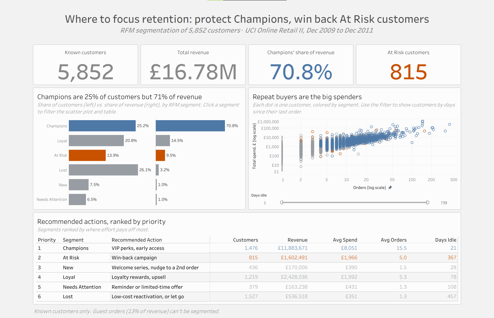

# Retail Customer Segmentation (SQL + Tableau)

**Which customers should the retailer prioritize, and what should it do for each group?**

This project segments 5,852 customers of a UK online retailer using RFM analysis (Recency, Frequency, Monetary value). The analysis is written in SQL (SQLite), and the results are presented in an interactive Tableau Public dashboard that pairs each customer segment with a recommended action.

It builds on my earlier [Retail Sales Dashboard](https://github.com/cyuhleavuh/retail-sales-dashboard) project (Python, Dash), which found that the top 1% of customers drive 31.3% of revenue. This project goes a step further: it groups *every* known customer and ranks where retention effort pays off most.

**[View the live dashboard on Tableau Public](https://public.tableau.com/app/profile/cait.oliva/viz/RetailCustomerSegmentation_17926246165180/CustomerSegmentation)**



---

## Key Findings

- **Champions are 25% of customers but generate 71% of revenue** (£11.9M). They average £8,051 in spend across 15.5 orders.
- **815 At Risk customers are the biggest recovery opportunity.** They spent almost as much as Loyal customers (£1,966 vs. £1,992 on average, across 5.0 vs. 5.3 orders) but haven't ordered in about a year: **£1.6M** in past revenue.
- **Lost is the largest segment by headcount but nearly worthless in revenue:** 26% of customers, 3% of revenue.
- **New and Needs Attention customers are mostly one-time buyers**: 14% of customers and about 2% of revenue together. The opportunity is a second order.

Context from the exploration queries (01–04):

- **Revenue held steady from 2010 to 2011** (£9.37M to £9.19M) even though orders fell from 19,627 to 18,220, because average order value rose from £478 to £504. The data ends on Dec 9, 2011, and a full December 2010 earned £329,617 more than Dec 1–9, 2011, more than 2011's entire £187,422 shortfall. The dip is likely just the missing weeks.
- **2011 started weak and finished strong:** revenue fell 9.9% year over year in Jan–Apr, then grew 6.5% in May–Nov, with the Sep–Nov peak season up 5.6%.
- **About 1 in 7 orders was cancelled** (11.9%–17.1% by month). The rate improved from 15.0% in 2010 to 13.6% in 2011, and was lowest during peak season.
- **Guest orders look like a different kind of transaction.** Orders without a Customer ID are 7.4% of orders but 13.3% of revenue, averaging £881 per order (vs. £459) with 77 distinct products per order (vs. 21).

## Recommendations

Segments are ranked by where effort pays off most, not by revenue alone.

| Priority | Segment | Customers | Share of revenue | Recommended action | Why |
|---|---|---|---|---|---|
| 1 | Champions | 1,476 | 70.8% | VIP perks, early access | Losing even a few is costly |
| 2 | At Risk | 815 | 9.5% | Win-back campaign | Proven repeat buyers, now slipping away |
| 3 | New | 436 | 1.0% | Welcome series, nudge to a 2nd order | A second order is what turns them into Loyal customers |
| 4 | Loyal | 1,219 | 14.5% | Loyalty rewards, upsell | Healthy; maintain and grow |
| 5 | Needs Attention | 379 | 1.0% | Reminder or limited-time offer | Cheap to try, modest upside |
| 6 | Lost | 1,527 | 3.2% | Low-cost reactivation, or let go | Low value; minimal spend |

**How to tell if it works:** test the win-back offer on half of the At Risk customers and compare their return rate with the other half (an A/B test), before rolling it out to everyone.

**Size of the opportunity (illustration):** if a win-back campaign brought back 10% of At Risk customers at their past average spend, that's about 82 customers × £1,966 ≈ **£160,000**. This is a scenario, not a forecast: average spend covers two years of buying, and actual response rates would need testing.

---

## Approach

**Data.** [UCI Online Retail II](https://www.kaggle.com/datasets/ozlemilgun/online-retail-dataset): 1M+ transaction lines from a UK online retailer, Dec 1, 2009 to Dec 9, 2011. The data was cleaned in Python in my earlier project ([`RetailData_Cleaning.ipynb`](https://github.com/cyuhleavuh/retail-sales-dashboard/blob/main/RetailData_Cleaning.ipynb)) and loaded into SQLite with `load_data.py`.

**Validation.** Before any analysis, I reproduced the earlier project's headline totals in SQL (£19,359,238.44 revenue, 39,513 orders) to confirm the data loaded without loss or duplication.

**RFM scoring.** For each customer, SQL calculates days since their last order, number of orders, and total spend. Each measure is then scored 1–5 by splitting customers into five equal groups with `NTILE(5)`, where 5 is best:

| Score | Recency | Frequency | Monetary |
|---|---|---|---|
| 5 | Ordered in the last 20 days | 8+ orders | £2,883+ |
| 4 | 20–59 days | 4–8 orders | £1,202–£2,880 |
| 3 | 59–187 days | 2–4 orders | £603–£1,201 |
| 2 | 187–409 days | 1–2 orders | £285–£603 |
| 1 | 409+ days | 1 order | Under £285 |

**Segment rules.** Segments are built from recency and frequency scores, which together describe the customer relationship. Spend tends to follow frequency, so it's shown in the results rather than used in the rules.

|  | F 1–2 (once) | F 3 (a few) | F 4–5 (often) |
|---|---|---|---|
| **R 4–5** (recent) | New | Loyal | Champions |
| **R 3** (cooling) | Needs Attention | Loyal | Loyal |
| **R 1–2** (gone) | Lost | At Risk | At Risk |

### SQL queries

Each query is saved in its own file with its business question at the top and its results, findings and notes at the bottom.

| # | Business question | SQL skills |
|---|---|---|
| [00](sql/00_validation.sql) | Do the totals match the prior Python analysis? | Aggregates, data validation |
| [01](sql/01_yearly_kpis.sql) | What are total revenue, orders and average order value by year? | `GROUP BY`, aggregates |
| [02](sql/02_monthly_yoy.sql) | How did monthly revenue change versus the same month last year? | CTEs, `LAG()`, `UNION ALL`, conditional aggregation |
| [03](sql/03_cancellation_rate.sql) | What share of each month's orders were cancelled? | Multiple CTEs, `LEFT JOIN`, rates |
| [04](sql/04_known_vs_guest.sql) | How do orders with and without a Customer ID compare? | `CASE WHEN`, `SUM(...) OVER ()` for shares |
| [05](sql/05_rfm_base.sql) | For each customer: days since last order, number of orders, total spend? | Views, date math with `julianday()`, check queries |
| [06](sql/06_rfm_scores.sql) | How does each customer score from 1–5 on recency, frequency and spend? | `NTILE()` window functions, tiebreakers |
| [07](sql/07_rfm_segments.sql) | How many customers and how much revenue sit in each segment? | `CASE WHEN` segment rules, NULL checks |

Queries 05–07 save their results as SQL views (`customer_rfm` → `customer_scores` → `customer_segments`), so each step builds on the one before it.

### Workflow

```
Cleaned parquet files → SQLite (load_data.py) → SQL queries and views → CSV exports → Tableau Public
```

Tableau Public can't connect to SQLite directly, so SQL does the heavy lifting and hands Tableau small, clean tables. The dashboard is built from one per-customer file, so clicking a segment filters every chart, and its totals were checked against the SQL summary.

---

## Repo Structure

```
├── load_data.py        # Loads the cleaned parquet files into retail.db
├── sql/                # One query per file (00–07)
├── outputs/            # CSV exports that feed Tableau
│   ├── 02_monthly_yoy.csv
│   ├── 03_cancellation_rate.csv
│   ├── 07_customer_segments.csv
│   └── 07_rfm_segments.csv
├── images/             # Dashboard screenshot
└── README.md
```

## How to Run

1. Clone this repo and install the requirements: `pip install pandas pyarrow`
2. Run `RetailData_Cleaning.ipynb` from the [earlier project](https://github.com/cyuhleavuh/retail-sales-dashboard) and copy `cln_sales.parquet`, `sales.parquet` and `cncld.parquet` into a `data/` folder here.
3. Run `python load_data.py` to build `retail.db`.
4. Open `retail.db` in [DB Browser for SQLite](https://sqlitebrowser.org/) (or any SQLite client) and run the files in `sql/` in order. Queries 05–07 create views that later queries depend on, so save the changes to the database after running them.

## Limitations

- **Only known customers can be segmented.** Guest orders (13.3% of revenue) have no Customer ID.
- **The date range is uneven.** 2009 covers December only, and 2011 ends on December 9.
- **Revenue is gross.** Cancellations are tracked separately and can't be linked to their original orders, so they aren't subtracted.
- **Recency is measured from Dec 10, 2011**, the day after the last order, since the data is historical.
- **Segment rules follow a common RFM convention**, not thresholds tuned to this business. One-time buyers make up 28% of customers, so frequency scores 1 and 2 both mostly mean "ordered once," and some 2-order customers fall into At Risk or Loyal.
- **The recommendations are untested.** Each should be trialed (for example, with an A/B test) before a full rollout.

---

**Tools:** SQL (SQLite), Python (pandas), Tableau Public, DB Browser for SQLite

**Author:** Cait Oliva · [Tableau Public](https://public.tableau.com/app/profile/cait.oliva)
